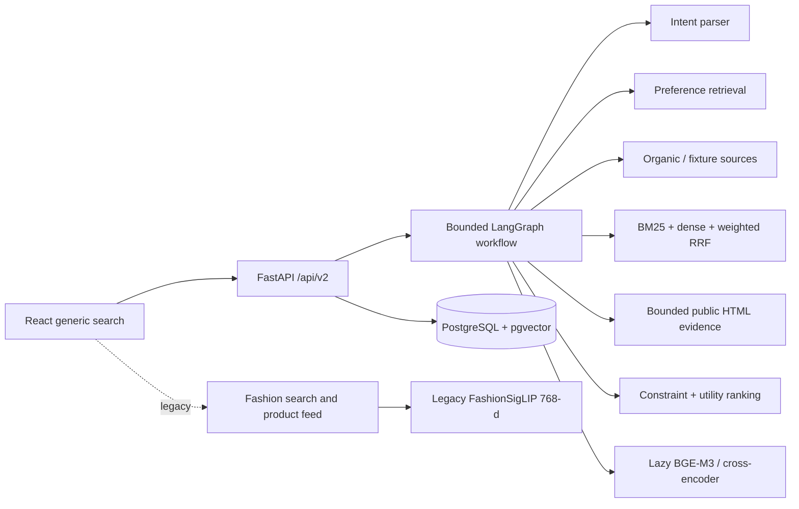

# POSE v2 architecture

## Compatibility boundary

POSE v2 is introduced beside the current fashion search rather than replacing its endpoints or tables. The new generic experience uses `/api/v2`, and the existing `/api/pse`, product feed, image search, and 768-dimensional FashionSigLIP API remain available as legacy paths.

## Boundaries

- `app/api` owns authentication and HTTP/WebSocket boundaries.
- `search_engine` owns typed intent, candidate normalization, retrieval, filtering, ranking, budgets, and trace events. It does not depend on FastAPI request models.
- `sources` defines fixture and Google Organic SerpApi adapters.
- `gpu_server/generic_*` is a lazy generic text model API. Legacy image and FashionSigLIP routes remain isolated.
- New search persistence is additive: documents, 1024-dimensional embeddings, preferences, sessions, impressions, feedback, and traces. Revisions `0003_embedding_space_metadata` and `0004_session_preferences` record vector metadata and session preference ownership; pre-CLS vectors become stale without deleting document or search history.

## Runtime and fallback behavior

Fixture mode is deterministic and must be selected explicitly with `SEARCH_PROVIDER=fixture`. Production SerpApi mode requires a configured API key; it never switches to fixture results automatically. If the model server is unavailable, query conditioning uses the same deterministic hashing algorithm for the query, preferences, and every document in that dense channel. A channel with incompatible model vectors is skipped. BGE-M3 vectors use CLS pooling and carry model ID, model version, dimension, and pooling method. Cache reads match all of these fields and the current document content hash. Revision 0003 invalidates old mean-pooled cache rows by changing their version key; their records remain available for inspection. Reranking and semantic judgments report fallback status when their model is unavailable. Database persistence is optional for local fixture searches; account-backed legacy routes still require their configured database.

The request path queries cached CLS-pooled BGE-M3 document vectors from pgvector before local hybrid ranking and stores fresh public candidates and vectors under a model/version/dimension/pooling/content-hash key. Evidence retrieval completes before document embedding so the vector and cache hash represent the same full text. The repository is optional when no database is configured.

Runtime search state uses separate browser `session_id`, API `search_id`, and workflow `execution_id` values. Only allowed state transitions can publish a terminal event, and event sequence numbers continue increasing after old events are trimmed. Completed in-memory sessions expire after two hours and the registry keeps at most 500 entries; PostgreSQL can restore completed search responses after eviction. Feedback inserts and preference updates share a transaction guarded by the unique owner/idempotency key. Session preferences are keyed by the authenticated owner and browser session ID.

## Security and authorization

REST search and preference routes use the existing JWT dependency and derive the owner ID from verified claims. WebSocket URLs require a signed token and verify session ownership; clarification-required searches send their terminal event and then close. Evidence fetching resolves each host, rejects any non-public DNS answer, and connects to the exact validated IP while retaining the original Host header and TLS SNI. Each redirect destination is validated and checked against that origin's robots policy. HTML size is bounded. Retrieved page text is treated as untrusted data; semantic evaluation uses a bounded structured judgment and rejects quotes absent from the retrieved source.

## Known operational limits

- Search event history is in memory and is not replayed after process restart. When no database is configured, feedback idempotency is process-local; with PostgreSQL, the owner/idempotency constraint is enforced transactionally.
- GET can restore completed searches from PostgreSQL, but WebSocket event replay after process restart is not implemented.
- Search responses and the trace table include stage latency and provider/model fallback spans. User-facing warnings identify hashing and reranker fallback. Provider queries, full preference values, and model reasoning are not written to trace attributes.
- CI runs migrations and persistence tests against disposable PostgreSQL/pgvector. A production database, external provider, real web quality, and loaded-model behavior remain environment-dependent.
