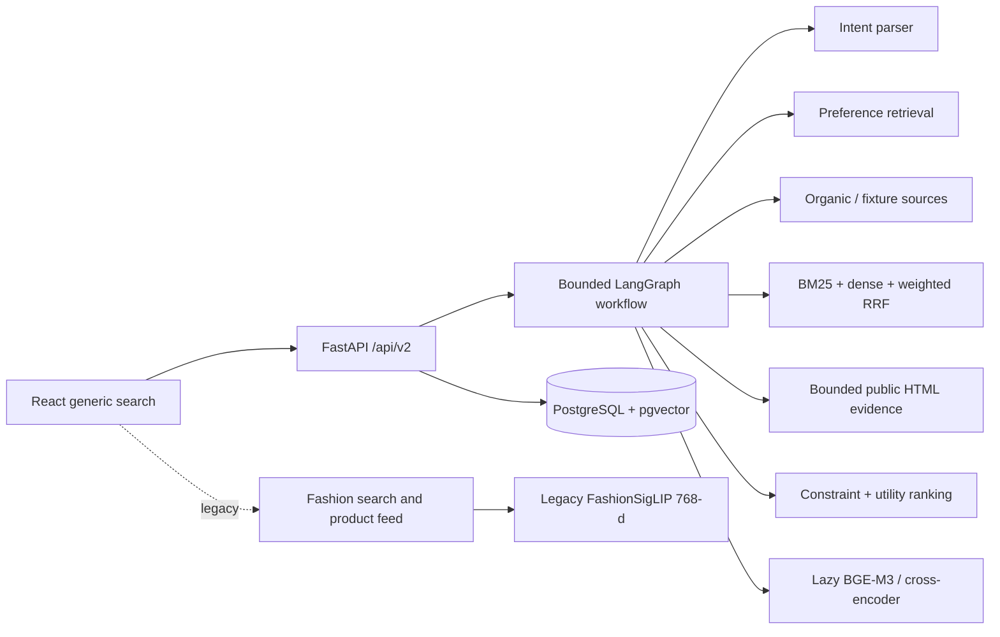

# POSE v2 architecture

## Compatibility boundary

POSE v2 is introduced beside the current fashion search rather than replacing its endpoints or tables. The new generic experience uses `/api/v2`, and the existing `/api/pse`, product feed, image search, and 768-dimensional FashionSigLIP API remain available as legacy paths.

## Boundaries

- `app/api` owns authentication and HTTP/WebSocket boundaries.
- `search_engine` owns typed intent, candidate normalization, retrieval, filtering, ranking, budgets, and trace events. It does not depend on FastAPI request models.
- `sources` defines fixture and Google Organic SerpApi adapters.
- `gpu_server/generic_*` is a lazy generic text model API. Legacy image and FashionSigLIP routes remain isolated.
- New search persistence is additive: documents, 1024-dimensional embeddings, preferences, sessions, impressions, feedback, and traces.

## Runtime and fallback behavior

Fixture mode is deterministic and requires no network key. If a configured local model server is unavailable, query and document vectors use a stable hashing representation and reranking falls back to hybrid relevance. If SerpApi has no key, the default provider uses the fixture adapter. Database persistence is optional for local fixture searches; account-backed legacy routes still require their configured database.

The request path queries cached BGE-M3 document vectors from pgvector before local hybrid ranking and stores fresh public candidates and vectors under a model/version/content-hash key. The repository is optional when no database is configured. A live PostgreSQL/pgvector read/write has not been exercised in this checkout.

## Security and authorization

REST search and preference routes use the existing JWT dependency and derive the owner ID from verified claims. WebSocket URLs require a signed token and verify session ownership. Evidence fetching validates DNS answers and redirects, bounds HTML size, and checks robots policy. Retrieved page text is treated as untrusted data and is never used as instructions.

## Known operational limits

- Search session event history and feedback idempotency keys are in memory; completed request/response state and durable feedback can be stored when the database is configured.
- GET can restore completed searches from PostgreSQL, but WebSocket event replay after process restart is not implemented.
- The trace table currently stores a compact event summary; detailed stage latency exists in the in-process trace object but is not fully persisted.
- pgvector document-cache reads and writes are wired; live database behavior and HNSW-scale performance remain unverified.
