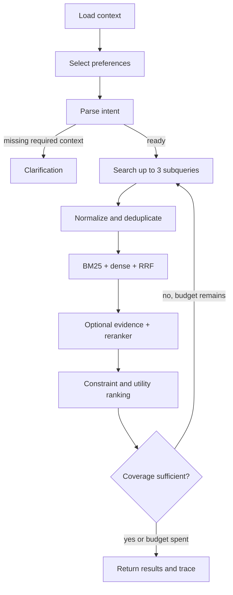

# Search pipeline

## Request flow

1. Validate `SearchRequest`, context, limit, and typed criteria.
2. Load only the authenticated user's active preferences and select up to five relevant entries.
3. Parse structured intent with an optional OpenAI-compatible local LLM; deterministic parsing handles fallback and fixture mode.
4. Ask for clarification when location-dependent intent has no location.
5. Search the optional PostgreSQL/pgvector cache with the query embedding while searching up to three distinct subqueries concurrently through a source adapter.
6. Canonicalize and deduplicate URLs, retaining cache and source rank per query.
7. Run BM25 and dense retrieval, then weighted reciprocal rank fusion across cached, external, sparse, dense, and personalized dense channels. If BGE vectors are unavailable, use stable hashing vectors.
8. Optionally fetch evidence for up to 15 public HTML pages with URL, redirect, MIME, size, timeout, and robots checks; emit an evidence-stage event and trace summary.
9. Rerank up to the configured candidate limit (30 by default) when the model server is available; use transformed sigmoid scores only as one relevance feature.
10. Evaluate explicit criteria and exclusions. A hard violation is excluded; an unknown hard condition remains unverified.
11. Rank by relevance, preference compatibility, criterion evidence, and uncertainty, then return verified and unverified sets separately.
12. If fewer than three verified results remain or a hard criterion lacks verified evidence, run one deterministic refinement round within the shared 60-second, six-call budget.

## Runtime budgets

Default settings are in `project/backend/app/manage/settings.py` and can be overridden through `project/backend/.env`:

| Budget | Default |
| --- | ---: |
| Search rounds | 2 |
| Queries per round | 3 |
| External query calls | 6 |
| Concurrent provider requests | 4 |
| Candidate documents | 50 |
| Evidence fetches | 15 |
| Reranker candidates | 30 |
| Results | 10 |
| Deadline | 60 s |

`LLM_MAX_RETRIES` defaults to one retry with capped exponential backoff. `SEARCH_RELEVANCE_WEIGHT`, `SEARCH_PREFERENCE_WEIGHT`, `SEARCH_CONSTRAINT_WEIGHT`, `SEARCH_EVIDENCE_WEIGHT`, `SEARCH_UNCERTAINTY_PENALTY`, and `SEARCH_RESULT_THRESHOLD` control the utility ranker. Pydantic bounds candidate counts, retry counts, and feature weights.

The workflow is finite; no open-ended ReAct loop runs. The current retry planner is deterministic and appends unmet hard-criterion values or a small set of generic query suffixes. It is not an LLM-selected action/tool registry. PostgreSQL cache failures are recorded and fall back to the external provider path.

## Evidence semantics

Metadata or text can satisfy a criterion only when a supporting signal is present. A mismatch in structured metadata or positive evidence for an exclusion marks a violation. A missing mention is unknown, not proof of absence. Evidence fetch failures preserve snippet-only results and do not invent facts.

## API and events

- `POST /api/v2/search` returns a `search_id` with accepted status.
- `GET /api/v2/search/{search_id}` is the recovery path for status and final results.
- `POST /api/v2/search/{search_id}/clarify` starts a follow-up search with added context.
- `POST /api/v2/search/{search_id}/cancel` cancels its background task when possible.
- `WS /api/v2/ws/{search_id}?token=...` streams owner-checked events that include `search_id`.

Events include `EVIDENCE_CHECK_STARTED` even when evidence fetching is disabled or no candidate needs fetching, so clients can display a consistent stage transition.

Polling remains the frontend recovery path. After a backend restart, completed state can be recovered from PostgreSQL; in-memory WebSocket history cannot.
